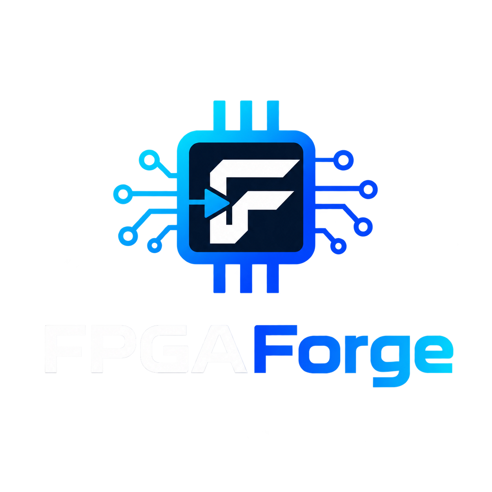
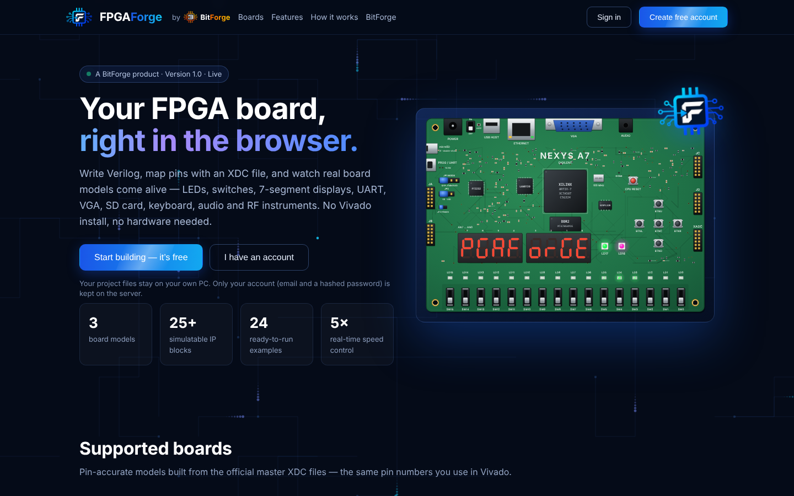
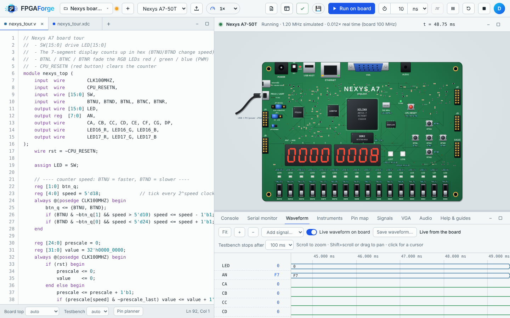
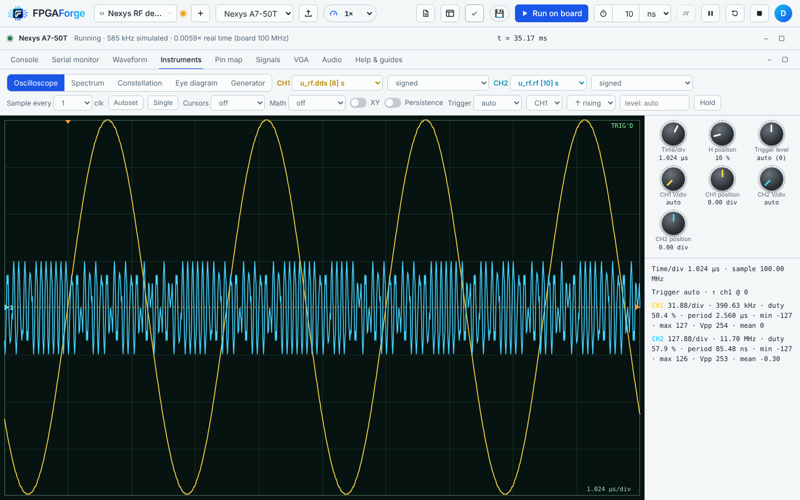
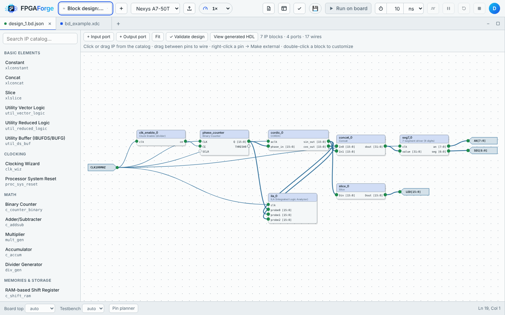
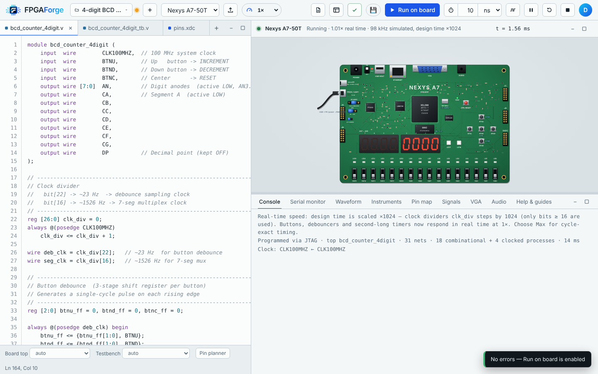
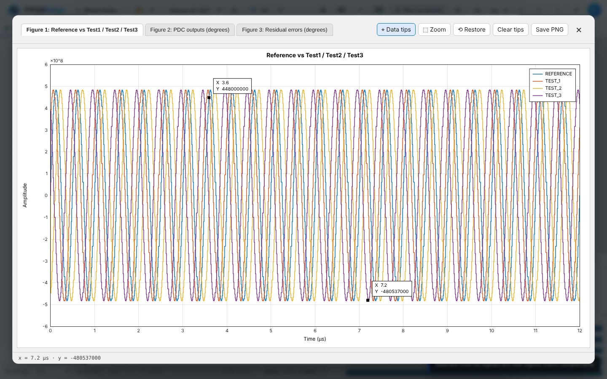
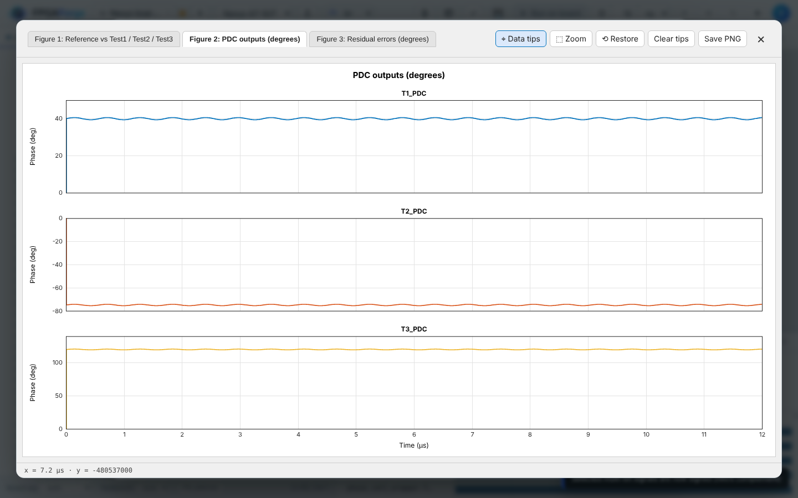
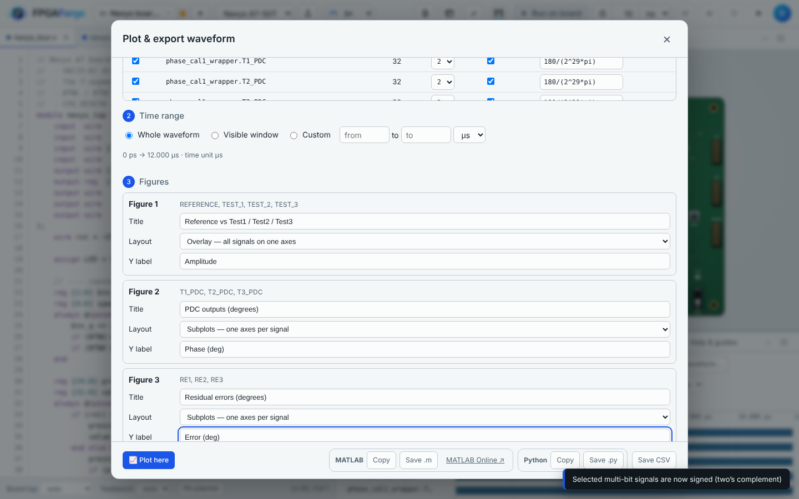
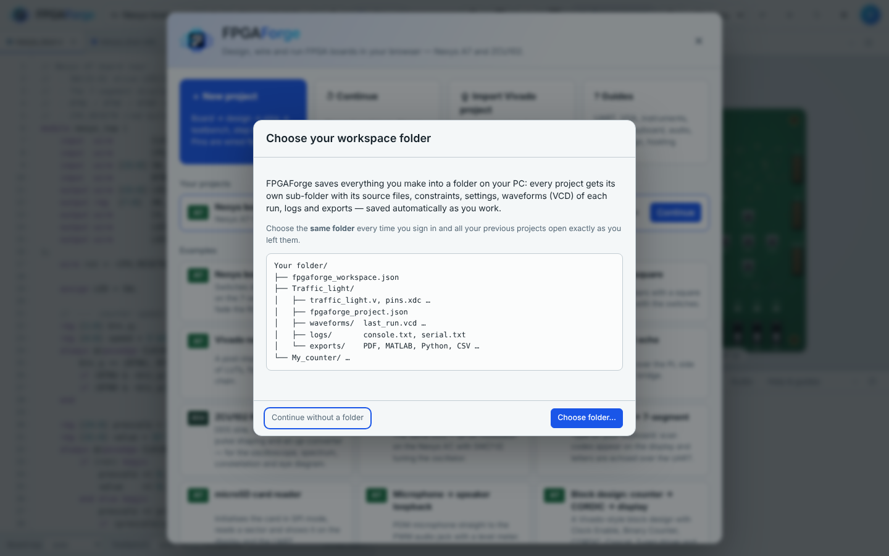

<div align="center">



### FPGA boards in the browser — Verilog to blinking LEDs, no installation.

[](https://dedeep-vlsi-fe-engg.github.io/FPGAForge/)
[](https://dedeep-vlsi-fe-engg.github.io/BitForge/)


**[Open FPGAForge](https://dedeep-vlsi-fe-engg.github.io/FPGAForge/)** · **[BitForge](https://dedeep-vlsi-fe-engg.github.io/BitForge/)** · **[VLSIForge](https://dedeep-vlsi-fe-engg.github.io/VLSIForge/)**

</div>

---

## Overview

**FPGAForge** is a browser-based FPGA development and simulation environment. Students and engineers write Verilog, assign pins with a Xilinx-style `.xdc` constraints file, and run the design on a detailed, pin-accurate model of a real development board — flipping switches, pressing buttons and watching LEDs, 7-segment displays, a serial terminal, a VGA monitor and measurement instruments respond, all from any modern browser with nothing to install.

Pin numbers follow the official master XDC files, so constraints move between FPGAForge and AMD Vivado® unchanged, and lab exercises translate step by step.

<div align="center">

</div>

<div align="center">
&nbsp;

</div>
<div align="center">
&nbsp;

</div>
<div align="center">
&nbsp;

</div>

---

## Features

### Design entry
- **Multi-file Verilog editor** with live error reporting, file tabs and a project menu
- **New-project wizard** — choose a board, start from a template or upload files, automatic pin assignment and an optional generated testbench
- **Pin planner** that writes the `.xdc` constraints file for you
- **Block design** canvas (IP Integrator style) with 25+ simulatable IP blocks and generated HDL
- **Vivado project import** — drop a zipped project folder (`.xpr`); sources, constraints, board and top modules are detected automatically

### Validation
- Syntax and elaboration checks, missing or duplicate pins, outputs on input-only pins
- Multiple-driver and combinational-loop detection, block-design DRC
- Vivado-style message codes (`HDL-SYN`, `XDC-0`, `UCIO-1`, `MDRV-1`, …), a link to the file and line, and a suggested fix for every error
- **Run on board** unlocks only after a clean validation

### Simulation
| Mode | Description |
|---|---|
| **Run on board** | Continuous simulation driving the interactive board model |
| **Run for** | Runs an exact time (ns, µs, ms, s or clock cycles), then pauses |
| **Run testbench** | Simulates a testbench module until `$finish` or a chosen time limit |
| **Speed control** | `0.25×` – `5×` real time, or `Max` for cycle-exact simulation |

**Real-time speed:** free-running clock dividers and long timer constants are scaled automatically, so button debouncers, one-second ticks and clocks behave exactly as on the real board at `1×`. The console lists every scaled divider and constant.

### Boards and peripherals
- Clickable **switches and buttons**, PWM-accurate **LEDs** and **RGB LEDs**, multiplexed **7-segment displays**
- **USB-UART** serial monitor (send and receive)
- **VGA** monitor, 640 × 480 at 60 Hz
- **microSD** card in SPI mode (CMD0 / 8 / 55 / 41 / 58 / 17 / 18 / 24 / 12, SDHC) with files you add
- **USB keyboard** as a PS/2 device (scan-code set 2)
- **PDM microphone** input and **PWM audio** output you can play back
- **Pmod** headers, **power switch** and **programming modes** (JTAG, QSPI flash, microSD, USB) with boot animations

### Results and instruments
- **Waveform viewer** — live recording while the board runs, cursors, zoom, radix and analog display styles, the whole run from 0 s to Stop
- **Oscilloscope** — time/div, trigger and volts/div knobs, Autoset, cursors, math channel, XY mode, persistence
- **Spectrum analyser** — FFT, Hann / rectangular window, averaging, max hold, peak table, I/Q mode
- **Constellation** and **eye diagram**
- **Function generator** driving any input port (sine, square, triangle, sawtooth, noise, DC)

### Plot · MATLAB · Python
Turn any waveform — from a board run, a testbench or an **imported VCD file** (for example a Vivado `pdc_dump.vcd`) — into publication-ready plots:

| Step | What you choose |
|---|---|
| **1. Signals** | Which signals, which figure each goes in, **signed** (two's complement) or unsigned, and a **scale** factor or expression such as `180/(2^29*pi)` |
| **2. Time range** | Whole waveform, visible window, or a custom from–to range |
| **3. Figures** | Title, layout (**overlay** with legend, or **linked subplots**) and Y-axis label |
| **4. Output** | Data embedded in the script, or a CSV file plus a script that reads it |

- **Plot here** — a MATLAB-style figure window inside FPGAForge: figure tabs, click a curve for an X / Y **data tip**, scroll to zoom, drag to pan, zoom box, restore view, Save PNG
- **MATLAB script** — copy and paste into MATLAB or [MATLAB Online](https://matlab.mathworks.com/), or save as `.m`; drawn with `stairs`, grid, legend, titles and `linkaxes`
- **Python script** — matplotlib with MATLAB's colour order, legend and click-to-pin data tips (`pip install matplotlib`)
- **CSV** — a Time column plus one column per signal

<div align="center">

</div>

### Block design IP catalog
| Category | IP blocks |
|---|---|
| Basic elements | Constant, Concat, Slice, Utility Vector Logic, Utility Reduced Logic, Utility Buffer |
| Clocking | Clocking Wizard, Processor System Reset |
| Math | Binary Counter, Adder / Subtracter, Multiplier, Accumulator, Divider Generator |
| Memories | RAM-based Shift Register, Block Memory Generator, FIFO Generator |
| DSP & RF | DDS Compiler, CORDIC, FIR Compiler |
| Debug | ILA (probes appear in the live waveform), VIO |
| FPGAForge library | Clock enable, debouncer, PWM, UART TX / RX, 7-segment driver |

### Exports
- **Waveforms** — VCD (GTKWave, Vivado), CSV, PNG, WaveDrom JSON, MATLAB `.m` and Python `.py` plotting scripts, for the whole run, the visible window or a custom range
- **PDF report** — board snapshot, pin map, whole-run waveform with detail segments, instrument screen, console log, serial output and all source files
- **Projects** — single project or all projects as `.zip`

### Supported boards
| Board | FPGA | Clock | Highlights |
|---|---|---|---|
| Digilent **Nexys A7-50T** | Artix-7 XC7A50T | 100 MHz | 16 switches, 16 LEDs, 2 RGB LEDs, 8-digit 7-segment, UART, VGA, microSD, keyboard, audio, microphone, Pmods |
| Digilent **Nexys A7-100T** | Artix-7 XC7A100T | 100 MHz | Same peripherals as the A7-50T |
| AMD Xilinx **ZCU102** | Zynq UltraScale+ XCZU9EG | 125 / 300 MHz (differential) | 8 LEDs, 8 DIP switches, 5 buttons, UART (PL), fan, JTAG / QSPI / SD boot modes |

### Examples
24 ready-to-run examples, including 11 Nexys A7 course projects:

| Board | Examples |
|---|---|
| Nexys A7 | Board tour · UART hello + echo · VGA bouncing square · Vivado netlist (funcsim) · RF demo: DDS + QPSK · USB keyboard → 7-segment · microSD card reader · Microphone → speaker loopback · Block design: counter → CORDIC → display |
| Nexys A7 course projects | Full adder · 8-to-1 multiplexer · 1-to-8 demultiplexer · BCD to 7-segment · 7-segment calculator · Universal shift register · 4-digit BCD counter · PWM LED brightness · Traffic light controller · 12-hour digital clock · USB keyboard decoder |
| ZCU102 | Knight rider · UART2 echo · RF demo: DDS + QPSK |
| Any board | Counter + testbench |

---

## Accounts & your data

| | |
|---|---|
| **Sign-in** | Free accounts with email and password (Firebase Authentication), **email verification** and password reset |
| **What the server stores** | Only your email and sign-up / sign-in times |
| **Where your designs live** | In a **workspace folder on your own PC** that you choose after signing in |
| **Auto-save** | Every project is saved in its own sub-folder — source files, constraints, settings, the waveform (VCD) of every run, console and serial logs, and every export |
| **Coming back** | Choose the same folder (one click to reconnect) and all your previous projects reopen exactly as you left them |
| **Leaving** | Closing the tab or signing out with unsaved changes asks whether to save first |

```
Your workspace folder/
├── fpgaforge_workspace.json
└── <Project name>/
    ├── *.v, *.xdc, *.bd.json …     source files
    ├── fpgaforge_project.json      board and settings
    ├── waveforms/                  last_run.vcd + the last 10 runs
    ├── logs/                       console.txt, serial.txt
    └── exports/                    PDF, MATLAB, Python, CSV, PNG …
```

> Folder auto-save requires **Google Chrome** or **Microsoft Edge** on a desktop / laptop. Other browsers keep work in browser storage, with project `.zip` export.

<div align="center">

</div>

---

## Getting started

1. Open **https://dedeep-vlsi-fe-engg.github.io/FPGAForge/**
2. **Create a free account** and click the link in the verification email
3. Choose your **workspace folder** on your PC
4. On the welcome screen, open an example — for example **Nexys board tour** — or start a **New project**
5. Press **Validate**, then **Run on board**
6. Click switches and buttons on the board; open **Waveform**, **Serial monitor** or **Instruments** to look inside the design
7. Press **📈 Plot · MATLAB · Python** in the waveform toolbar to plot the result or export MATLAB / Python code

New to FPGAs? **Help & guides** inside the app is a complete user manual, from the first project to block design.

---

## Keyboard shortcuts

| Simulation | | Editor & dialogs | | Instruments | |
|---|---|---|---|---|---|
| `Ctrl+Enter` | Validate and run on board | `Ctrl+S` | Save (to PC folder when connected) | Drag knob | Adjust |
| `F8` | Pause / resume | `Esc` | Close dialog | Scroll on knob | Adjust |
| `Shift+>` | Faster speed | Double-click tab | Rename file | Arrow keys | Fine adjustment |
| `Shift+<` | Slower speed | Right-click signal | Waveform display options | Double-click knob | Reset |

---

## Technology stack

- **Frontend:** vanilla JavaScript, SVG, HTML5 Canvas, CSS — delivered as a single self-contained `index.html`
- **Simulation:** custom Verilog compiler (lexer, parser, elaborator, code generation) and event-driven simulator with levelised combinational evaluation, Xilinx primitives and design-time scaling for real-time speed
- **Peripherals:** cycle-level models of UART, VGA, microSD (SPI), PS/2 keyboard, PDM microphone and PWM audio
- **Instruments:** FFT-based spectrum analyser, triggered oscilloscope, constellation and eye diagrams
- **Reports & plots:** jsPDF for PDF reports; built-in VCD parser and writer, CSV, PNG, WaveDrom, ZIP, MATLAB and Python code generators, and a canvas plotting engine with MATLAB-style figures and data tips
- **Accounts:** Firebase Authentication + Cloud Firestore (Spark plan)
- **Storage:** File System Access API (user's PC) with browser storage fallback
- **Hosting:** GitHub Pages

---

## Repository structure

```
FPGAForge/
├── index.html          # The complete application
├── firestore.rules     # Firestore security rules (profiles + admin read)
├── README.md
└── assets/             # Logos and screenshots used in this README
```

## Deployment

1. Upload `index.html` to this repository (branch `main`, root folder)
2. **Settings → Pages → Deploy from a branch → `main` / `root`**
3. In the Firebase project: enable **Email/Password** sign-in, add `dedeep-vlsi-fe-engg.github.io` to **Authorized domains**, and publish `firestore.rules`
4. The Firebase web configuration and admin email are set in the settings block at the top of `index.html`

---

## Limitations (Version 1)

- Arithmetic operates on signals up to **32 bits** wide; wider registers are supported for text labels and equality checks
- `x` simulates as 0 and `z` as a pulled-up 1
- **VHDL**, SystemVerilog classes and interfaces, and processor IP (MicroBlaze, Zynq PS) are not supported
- MMCM / PLL, block RAM and DSP primitives in implemented netlists are not modelled
- Very busy signals (such as a 100 MHz clock) are stored in the waveform for about their first 1.5 million changes
- A `.bit` file can be inspected but not simulated
- Imported VCD values wider than 52 bits lose precision in plots; `x` and `z` are read as 0
- MATLAB scripts need MATLAB R2016b or newer (`sgtitle` from R2018b is used when available); Python scripts need matplotlib

---

## Roadmap

Version 2 is being planned. Boards proposed for version 2:

| Priority | Board | FPGA / SoC | Why |
|---|---|---|---|
| 1 | Digilent **Basys 3** | Artix-7 XC7A35T | The most widely used teaching board |
| 1 | Digilent **Arty A7-35T / 100T** | Artix-7 | Popular for projects, Arduino / Pmod headers |
| 1 | Digilent **Zybo Z7-10 / Z7-20** | Zynq-7000 | Standard Zynq teaching board |
| 1 | TUL **PYNQ-Z2** | Zynq-7020 | Python-productivity board used in many labs |
| 1 | Avnet **ZedBoard** | Zynq-7020 | Classic Zynq development board |
| 2 | Digilent **Nexys Video** | Artix-7 XC7A200T | HDMI, audio and larger designs |
| 2 | Digilent **Cmod A7** | Artix-7 XC7A35T | Breadboard-friendly module |
| 2 | Digilent **Arty Z7-20** | Zynq-7020 | HDMI in / out, low-cost Zynq |
| 2 | AMD **Kria KV260 / KR260** | Zynq UltraScale+ | Vision and robotics starter kits |
| 2 | AMD **ZCU104** | Zynq UltraScale+ EV | Video codec and embedded vision |
| 3 | AMD **ZCU111** | Zynq UltraScale+ RFSoC | RF data converters — pairs with the RF instruments |
| 3 | AMD **ZCU216** | Zynq UltraScale+ RFSoC Gen 3 | Multi-channel RF and phased-array work |
| 3 | AMD **ZCU106** | Zynq UltraScale+ EV | High-end video |
| 3 | AMD **VCK190** | Versal AI Core | AI Engines and the newest AMD architecture |
| Optional | Terasic **DE10-Lite / DE1-SoC** | Intel MAX 10 / Cyclone V | Intel-based labs (needs Quartus-style pin files) |

Also planned: more IP blocks and wider arithmetic. Feedback and suggestions are welcome via the contact below.

---

## Contact

**BitForge** — [dedeep-vlsi-fe-engg.github.io/BitForge](https://dedeep-vlsi-fe-engg.github.io/BitForge/)
Email: [fpgaforgedss@gmail.com](mailto:fpgaforgedss@gmail.com)

---

<div align="center">


**FPGAForge is a BitForge company** · Developed by **DSS with Claude**

<sub>FPGAForge is an independent educational project and is not affiliated with, endorsed by, or sponsored by AMD or Digilent. AMD, Xilinx, Vivado, Zynq, UltraScale+ and Artix are trademarks of Advanced Micro Devices, Inc. Nexys is a trademark of Digilent Inc.</sub>

<sub>© 2026 BitForge. All rights reserved.</sub>

</div>
